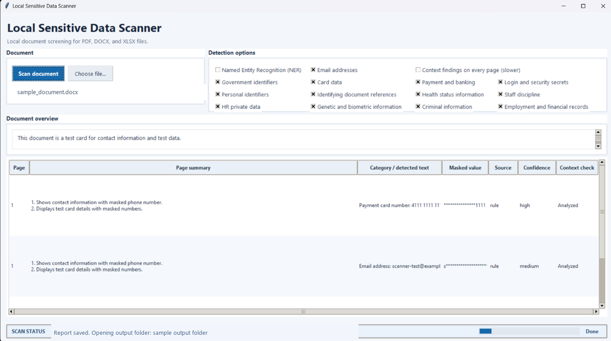

# Local Sensitive Data Scanner

A local pre-sharing screening and best-effort redaction tool for PDF, DOCX, and XLSX documents.
Use it to look for sensitive data before sharing a file, uploading it to an internet service, or
feeding it to an LLM. It reports possible matches page by page and can create a separate redacted
copy for review; it never modifies the original.

Its strengths are document-focused scanning across common personal, financial, health, employment,
and credential data; configurable detection categories; and a local workflow with optional NER and
local Ollama contextual analysis. The GUI also saves human-readable and machine-readable reports.
This makes it useful as a review step before sharing—not as a guarantee of anonymization or a
replacement for enterprise data-loss-prevention systems.

> Detection is incomplete and redaction is best-effort. Review the exported copy before sharing:
> missed, embedded, or unmappable content may still expose sensitive information. "No findings"
> does not mean a file is safe.



*Example interface using test data.*

## Layers
1. **Rules** - regex plus validators (Luhn, SSN/ITIN structure, IBAN checksum, ABA checksum).
   All category groups are enabled by default; individual groups can be excluded for a scan.
2. **NER** (`--ner`) - Presidio for names/addresses. Optional.
3. **LLM** - local Ollama (default `qwen3:4b`, temperature 0) summarizes every page and checks
   for contextual findings when signals are present. Enable **Context findings on every page**
   in the GUI or pass `--deep` to check every page. Ollama must be running locally with the
   selected model installed. Recognized sensitive values in enabled categories are masked before
   page text is sent to Ollama. Long pages are analyzed in overlapping chunks.

The GUI groups **Named Entity Recognition (NER)** and **Email addresses** checkboxes with all
sensitive-data category checkboxes under **Detection options**. Email and sensitive-data categories
are selected by default; NER is optional and off by default. Uncheck an item to skip its detection
in that scan. Contextual findings are signal-gated by default; the GUI's every-page option or CLI
`--deep` asks the model to check every page, which takes longer. The CLI accepts repeatable
`--disable-category CATEGORY` options; for example:

```
python sensitive_data_scanner.py file.pdf --disable-category health_status_information --disable-category genetic_biometric
```

Available category IDs: `government_identifiers`, `payment_cards`, `payment_banking`,
`login_secrets`, `personal_identifiers`, `identifying_documents`, `health_status_information`,
`staff_discipline`, `hr_private_data`, `genetic_biometric`, `criminal_information`, and
`employment_financial`. The former `health_information` CLI category remains accepted as an alias
for `health_status_information`.

The GUI's **Health status information**, **Staff discipline**, and **HR private data** options
independently control matching rules and local-model findings for diagnoses/treatment, employee
disciplinary matters, and private employee records such as payroll or benefits. Unchecking one
leaves matching text unmasked for that scan.

Disabling a category intentionally leaves its values unflagged and unmasked, including in the
local-model input. This is a per-scan screening choice, not an assurance that the remaining
categories protect excluded data. Detection is pattern-based and incomplete: arbitrary secrets,
contextual health or personal details, and sensitive information inside images may be missed.
Review the source and any redacted copy manually; a clean scan does not mean a document is safe.

Saved-report values are masked by default. Uncheck the GUI's **Email addresses** checkbox to skip
email detection and redaction. Ignored addresses may remain visible in text sent to the local
Ollama model and in reports or redacted copies; this setting does not remove them from the document
or model input. The CLI equivalent is `--ignore-emails`.

For compatibility, `--keep-emails` still detects email addresses but leaves them unmasked in
findings, summaries, reports, and redacted copies. This reduces privacy protection; review outputs
carefully before sharing. Reports are sensitive even when masking is enabled.
The GUI dashboard's Category column shows the actual matched text after its category label
for rule- and NER-based findings. Language-model findings show their safely masked evidence.

## Run
```
pip install -r requirements.txt
python sensitive_data_scanner.py                         # open the desktop GUI
python sensitive_data_scanner.py --gui                   # open the desktop GUI
python sensitive_data_scanner.py D:\            -o reports            # a mounted USB drive
python sensitive_data_scanner.py file.pdf --model qwen3:4b -o reports
python sensitive_data_scanner.py file.pdf --ignore-emails -o reports
```
Output: `reports/scan_<timestamp>.html` (human) and `.json` (data).

## Windows executable
Install PyInstaller in the build environment and run:

```
python -m PyInstaller --noconfirm "Local Sensitive Data Scanner.spec"
```

The onedir application is created at
`dist/Local Sensitive Data Scanner/Local Sensitive Data Scanner.exe`. Distribute the whole
folder, including `_internal`; Ollama and its selected model must still be installed on the
target computer.

The GUI lets you choose one PDF, DOCX, or XLSX file and displays up to eight numbered key points
for every page (one point per line) alongside masked findings and whether contextual analysis ran.
A document overview panel summarizes the document's
type and purpose and lists its three main points; the HTML report includes the same overview.
The bottom status bar shows scanning activity, completed pages/chunks, finding totals, and
the current processing stage.
Ollama is required for every scan; NER remains optional. Tkinter is included with standard
Windows and most desktop Python installations.
After a successful scan, the GUI creates a unique
`YYYYMMDD_HHMMSS_<scanned-file-name>` subfolder beside the selected file and automatically saves
a separate redacted copy and the HTML/JSON report there. The original is unchanged. No
confirmation or save-location prompts appear; File Explorer opens the output folder when
processing finishes.

Documents are analyzed by Ollama running locally on the PC at `127.0.0.1`. Document text
is sent to that local service, not to an internet-hosted LLM. The scanner does not monitor or
change network adapter states.

Summaries are generated from text with recognized values masked and are additionally checked
for common sensitive patterns. This cannot guarantee that an AI-generated summary contains no
sensitive information; review summaries before sharing reports. Scanning stops with an error
if the local Ollama service or selected model is unavailable.

After a successful scan, the GUI automatically creates a separate redacted copy. It replaces
only the matched characters from enabled categories with `X`s and preserves the surrounding text;
the original is unchanged. Rule, name-heuristic, and optional NER matches are supported. LLM-only
findings cannot be mapped to exact source positions and are not redacted. PDF matches must map to
selectable text; otherwise export is refused rather than creating a potentially incomplete
redaction. Unscanned content may remain, so review the copy before sharing. LLM page summaries
are never used as redaction locations.
PDF redaction requires optional PyMuPDF; check its AGPL
license with legal before installing:
`python -m pip install PyMuPDF`. DOCX/XLSX redaction uses the core dependencies.
DOCX redaction maps text across formatted runs and hyperlinks; unsupported or inconsistent
document text mappings fail closed rather than saving a partial redaction.

## Built-in safeguards
- Works on a private temp copy; the original (USB) is never opened for writing; temp copy is deleted after.
- Refuses macro-enabled Office files (.docm/.xlsm/.dotm/.pptm).
- Limits: 100 MB/file, 500 pages, zip-bomb check for DOCX/XLSX.
- Refuses non-local Ollama hosts, proxies, and redirects.
- Redacted-copy export never overwrites the original and replaces matched characters with Xs.
- PDF pages with no readable text (e.g. scans without OCR) are flagged for manual review.
- PDF pages containing images are OCR-scanned when Tesseract is available; failures are reported
  as coverage warnings.

## Station hardening checklist
- [ ] Wi-Fi and Bluetooth disabled in BIOS; Ethernet unplugged/disabled; BIOS password; Secure Boot on; USB boot disabled
- [ ] Full-disk encryption; no domain join, no saved credentials
- [ ] USB: auto-mount/autorun off; input mounted read-only (noexec,nosuid,nodev); allow mass-storage class only (e.g. USBGuard)
- [ ] Do not write to the user's own stick by default; output via screen, print, or company-owned encrypted stick
- [ ] Work folder in RAM (tmpfs) or wiped after every session; swap off/encrypted; no content in logs
- [ ] Scanner runs as an unprivileged user in a sandbox (no network), with CPU/memory/time caps
- [ ] Ollama bound to 127.0.0.1; auto-update off; OLLAMA_NOHISTORY=1; no model pull/create on this machine
- [ ] Updates only via a vetted company-owned update stick: hash-pinned wheels, SHA-256-checked Ollama and models; keep a patch log
- [ ] Canary-file test (fake SSNs/cards) and packet-capture check before go-live; security review sign-off
- [ ] Legal/HR sign-off, user notice/consent, report retention rule

## Known limits
- The scanner can miss items; keep a human reviewer. Category controls select which checks run,
  but they do not enable complete semantic detection for every type in a category.
- Name-pattern findings are limited to explicitly labeled names to avoid treating title-case
  headings as people; possible names are still masked before local-model analysis. Enable optional
  NER for additional name and address detection.
- Identity documents and sensitive details in images are not reliably identified or redacted by
  text patterns. PDF image text is OCR-scanned when Tesseract is available; failed OCR is flagged.
- The Presidio layer's context snippets are not yet fully masked (rules layer is).
- DOCX scanning covers body paragraphs, tables, header/footer paragraphs, author metadata,
  comments, and text boxes. Comments and text boxes may remain in redacted copies; reports flag
  this when such content is present.
- XLSX scanning checks formula text and cached values. Missing cached formula results are flagged
  because the calculated values cannot be verified.
- Redaction replaces the detected match characters with Xs; manually review the output.
- OCR needs the Tesseract program installed on the station.

## License
This project is released under the MIT License; see [LICENSE](LICENSE). Optional PyMuPDF
installation is separately subject to its AGPL license, as noted above.

## How the LLM layer avoids false alerts (v2)
- **Grounded evidence.** The model must copy a short phrase (max 6 words) from the page for every finding. If the phrase is not really on the page, the finding is dropped. Names and numbers in the phrase are masked.
- **Closed categories.** Only five person-specific categories are accepted (HR action, health, pay of a named person, background/investigation/legal matter, other personal data). Company financials, lists of officers and the organization's own address are explicitly not findings.
- **Model-only findings are never "high".** They show as low confidence, and as medium only when a rule/NER finding or an HR-term hit on the same page backs them up.
- **Gated by default.** Every page still gets a summary, but the contextual-findings question is asked only when the page has a signal (an identifier, or HR/health/pay wording together with a person indicator). The GUI's every-page option and CLI `--deep` ask it on every page. Reports identify pages where contextual findings were signal-gated.
- HR wording such as "terminated" is no longer masked in the text the model reads; it is context, not a value.
- Regression test: a public annual report should give 0 LLM findings.
